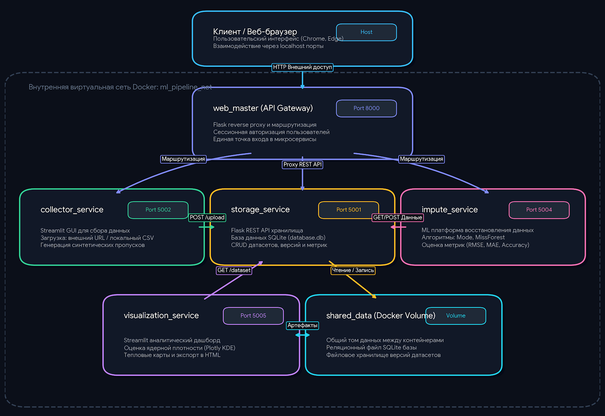

# Impute Hub


## 1. Назначение сервиса

Данный сервис предназначен для анализа качества обработки пропусков в табличных данных различными алгоритмами: мода, MissForest, алгоритм на ассоциативных правилах.

В приложении возможно добавлять свои наборы данных добавляя их из локального источника или скачивая по url-ссылке, выводить различные графики, анализирующие эффективность импутации (например KDE исходного и импутированного распределений, тепловая карта пропусков, построение графиков качества импутации по отдельным колонкам и др.).

Кроме того для удобства запуска сервиса предусмотрена возможность его запуска путем клика на иконку приложения.

## 2. Архитектура сервиса

Приложение разделено на 5 сервисов:
1. **collector_service** - сервис по автоматическому сбору датасетов в базу данных, а также созданию пропусков в них. Микросервис допускает 2 способа добавления датасетов: путем скачивания по url-ссылке или путем добавления с локального устройства. После добавления датасета возможно создать выбранный процент пропусков и сохранить датасет в базу данных.
2. **storage_service** - микросервис, реализующий API и бекенд базы данных, хранящей датасеты и метрики импутации. Основная задача - корректно регистрировать в базе данных приходящие наборы данных, а также отдавать другим компонентам необходимую информацию и данные для корректной работы.
3. **impute_service** - микросервис по импутации пропусков. Пользователь выбирает из базы данных грязный набор данных, выбирает алгоритм и запускает импутацию пропусков. По звершении импутации выводятся метрики качества восстановления пропусков, графики анализа импутации по каждой коллонке. Импутированный датасет можно добавить в базу данных, а также скачать график качества импутации.
4. **visualization_service** - микросервис по построению подробного визуального анализа искомого датасета и импутированного. Возможен анализ пропусков с помощью построения тепловой карты, анализ вероятностных распределений при помощи KDE, построение графиков эффективности импутации каждого алгоритма.
5. **web_master** - микросервис, являющийся посредником между пользователем и остальными пользователями. Проводит авторизацию пользователя, организует его обращение к определенному сервису, а также является прокси-сервером для остальных микросервисов при работе друг с другом.

Для хранения данных используется **shared_data**, хранящая в себе csv-файлы датасетов, json-конфиги датесетов, а также базу данных *database.db* СУБД SQLite, хранящую в себе таблицы с данными по датасетам и метрикам качества импутации. 



## 3. URL сеhвисов

```text
Микросервис    Внешний URL (для браузера)  Внутренний URL (для запросов в Docker)
Web Master     http://localhost:8000       http://web_master:8000
Collector      http://localhost:5002       http://collector_service:8501
Impute         http://localhost:5004       http://impute_service:8501
Visualization  http://localhost:5005       http://visualization_service:8501
Storage        http://localhost:5001       http://storage_service:5001
```

## 4. Запуск программы

Возможны 2 способа запуска программы:

1. Через терминал - при запущенном Docker Desktop выполнить следующую команду:
```bash
git clone https://github.com/Arseny05/impute_hub.git
cd impute_hub
docker compose up -d --build
# Проверка статуса работы контейнеров
docker compose ps
```
2. Через иконку приложения - для автоматизации запуска разработан .bat - файл, позволяющий по клику на иконку на рабочем столе запускать daemon-процесс Docker Desktop, поднимать все контейнеры и автоматически переходить в браузер для работы с приложением.


